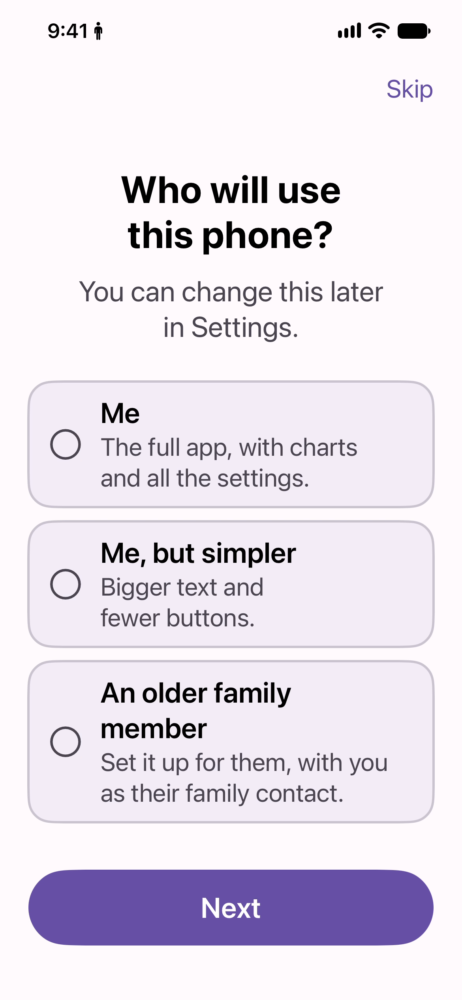
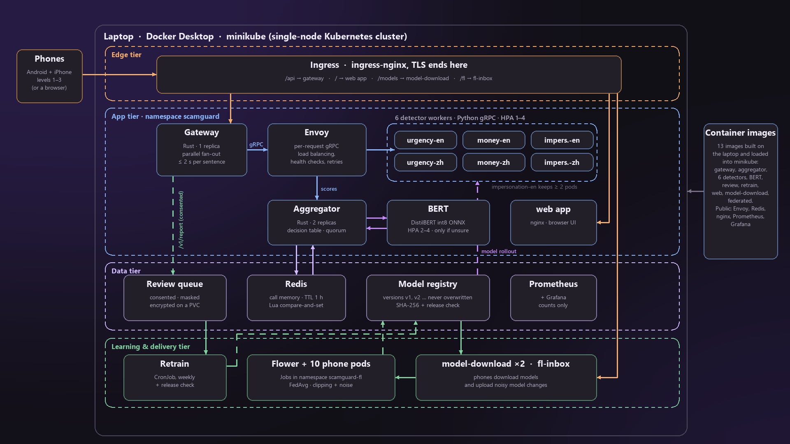

<p align="center">
  
</p>

<h1 align="center">ScamGuard</h1>
<p align="center"><b>A cloud-native system that warns you <i>during</i> a scam call — not after the money is gone.</b></p>

<p align="center">
  
  
  
  
  
  
  
</p>

Phone scams cost victims hundreds of millions of dollars a year, almost always through a live call where
the scammer builds urgency and authority until the victim transfers money themselves. By the time a bank
or a police report gets involved, the money is usually gone. **ScamGuard listens alongside the call** (on
Android and iPhone, in English and Mandarin) and warns the user while it is still happening.

Under the hood it's a distributed, fault-tolerant microservice backend: every sentence the caller says is
scored in parallel by six lightweight detectors, a stateless aggregator keeps the call's running verdict in
Redis, and a DistilBERT model is pulled in as a second opinion only when the fast models are unsure or
alarmed — a cascade that keeps the system fast, explainable, and still working if the expensive model is
slow or down. Everything runs on Kubernetes with autoscaling, health checks, and zero-downtime rollouts, and
users who want more privacy can run the detectors on-device instead, with the on-device models improving
over time through federated learning.

## Screenshots

<table>
<tr>
<td></td>
<td></td>
<td></td>
<td></td>
</tr>
<tr>
<td align="center">Onboarding</td>
<td align="center">Scam detected, live</td>
<td align="center">Unsure, caution</td>
<td align="center">Family dashboard</td>
</tr>
</table>

More: [after-call guidance](docs/images/screenshot-after-call.png) ·
[scam-awareness quiz](docs/images/screenshot-learn.png) ·
[privacy levels](docs/images/screenshot-privacy-levels.png)

The same app also ships as a native [Android client](android-app/) and a [browser replica](web/) with no
install required.

## Architecture



A phone sends each sentence over HTTPS to the cluster's only public entry point, the Ingress. From there:

- **gateway** (Rust, Actix-web + tonic) — the phone's one entry point. For every caller sentence it calls
  that language's three detectors at once over gRPC (≤ 1.4 s) and forwards whatever scores arrive in time
  to the aggregator.
- **Envoy** — sits in front of every scalable gRPC service. A plain Kubernetes Service load-balances
  *connections*, not *requests*, which does nothing for long-lived gRPC streams; Envoy spreads individual
  requests across replicas and health-checks every pod.
- **6 detectors** (Python, gRPC, scikit-learn) — `{urgency, money/OTP, impersonation} × {English, Mandarin}`,
  independently scalable, independently retrainable. Each is a calibrated TF-IDF + logistic-regression model
  trained to an explicit labelling rule, so a detector never invents a score for a sentence it can't explain.
- **aggregator** (Rust, tonic) — the judge. Holds no per-call state itself: a call's history lives in Redis
  (TTL 1 hour), so any aggregator replica can answer any sentence, and a restart loses nothing. Two replicas
  can safely race to update the same call thanks to optimistic concurrency control (a versioned Lua
  compare-and-set in Redis).
- **BERT** (multilingual DistilBERT, int8 ONNX) — the second opinion. Reads the call's last 5 sentences
  together rather than one at a time, and is asked only when the fast vote is uncertain or alarming — see
  [the cascade decision policy](#the-cascade-decision-policy) below.
- **Learning loop** — a consent-based review queue, a weekly retraining job, and a federated-learning round
  (Flower, differential privacy) that improves the on-device models without ever collecting raw calls.

Full request/response shapes, environment variables, and the Redis schema are documented further down in
[Gateway API](#gateway-api) and [Aggregator](#aggregator).

### The cascade decision policy

Six detectors score a sentence in about a millisecond each; DistilBERT needs 30–80 ms on a CPU. Running
BERT on everything would be slow and gives no answer if it's ever unavailable — running only the fast
models misses subtler scams. The cascade gets most of BERT's accuracy for a fraction of its cost, and never
stops answering if BERT goes down:

| Fast detectors | BERT (last 5 sentences) | Result |
|---|---|---|
| Calm (< 0.45) | Not asked | 🟢 SAFE |
| Unsure (0.45–0.6) | Not asked yet | 🟡 UNSURE, ask BERT |
| Unsure or alarmed | Scam (≥ 0.6) | 🔴 SCAM |
| Alarmed (≥ 0.6) | Uncertain (0.3–0.6) | 🟡 UNSURE |
| Alarmed (≥ 0.6) | Safe (< 0.3) | 🟡 UNSURE — never straight to SAFE |
| Any | BERT times out or is down | Fast-model result, capped at 🟡 unless two signals are ≥ 0.8 |

A single sentence can never flip a call straight to SCAM on its own: a red alert always needs BERT's
agreement (or two independent detectors scoring ≥ 0.8 if BERT is unreachable), and it only clears after two
consecutive BERT disagreements. The full rule table is in [Aggregator](#aggregator).

## Privacy levels

| Level | What runs where | What ever leaves the phone |
|---|---|---|
| **Cloud** | Interface only; everything scored in the cluster | Each sentence, scored and never stored |
| **Hybrid** | The three detectors + rules run on the phone | Only the last 5 sentences, masked, and only when the local verdict is unsure |
| **On-device** | Detectors + MobileBERT run on the phone | Nothing about calls — only optional, noised model updates |

Levels 2 and 3 run the same decision rules as the cloud aggregator (ported to Kotlin and Swift, with unit
tests asserting parity), so switching privacy level doesn't change what counts as a scam — only where the
scoring happens.

## Security & privacy

- **Nothing is stored by default.** A call's history lives only in Redis with a 1-hour TTL; the transcript
  text itself is never logged or persisted unless the user explicitly shares a finished call.
- **Explicit consent to share.** `POST /v1/report` is rejected outright without `consent: true` — there is
  no implicit collection path.
- **Masked, then masked again, then encrypted.** A shared call is masked on the phone, masked a second time
  on the server, and stored encrypted at rest (the encryption key is a Kubernetes Secret, kept separate from
  the data volume). Unapproved reports are deleted after 30 days.
- **HTTPS at the edge.** The Ingress terminates TLS with its own certificate authority; a plain-HTTP request
  is rejected.
- **Differential privacy in federated learning.** Phones never upload raw data, only a clipped, Gaussian-
  noised change to the on-device model, which the server averages across phones (FedAvg) before it can ever
  affect the shared model — and even then, only after passing the same release check as a cloud retrain.
- **Internal services stay internal.** Only the gateway, the web app, model downloads, and the federated
  update inbox are reachable from outside the cluster; the review queue and model registry are not.

## Reliability, at a glance

Measured on a single-node Kubernetes cluster (minikube), replaying real scripted scam and normal calls
end-to-end through the live stack:

| | Result |
|---|---|
| Median latency, light load | **41 ms** (p99 108 ms) |
| Median latency, heavy load (50 req/s) | 419 ms (p99 1,541 ms — still inside the 2 s budget) |
| Call-level detection F1 | **0.923** across 23 scripted calls (13 scam, 10 normal, English + Mandarin) |
| Pod killed mid-call (detector) | **0 failed requests** — call history and verdict survived |
| Pod killed mid-call (aggregator) | 6 of 1,628 requests failed (0.37%), all within 3 s; both replicas healthy after |
| Rolling model update / rollback mid-call | **0 failed requests**, 0 missing sentences |
| Autoscaling under load | Every detector and BERT scaled out automatically (CPU target 50%) |
| BERT unreachable | System kept deciding without it — the cascade's whole point |

These are real measurements from load, fault-injection and replay tests against a running cluster, not
estimates — see [Worker models](#worker-models) for per-model accuracy and known weak spots.

## Tech stack

| Layer | Technology |
|---|---|
| Gateway & aggregator | Rust (Actix-web, tonic/gRPC) |
| Detection models | Python, gRPC, scikit-learn (TF-IDF + logistic regression) |
| Second-opinion model | DistilBERT (multilingual), ONNX Runtime, int8 quantised |
| Call memory | Redis (optimistic concurrency via a versioned Lua script) |
| Service mesh / load balancing | Envoy (per-request gRPC load balancing + health checking) |
| Orchestration | Kubernetes (minikube for local demo), HPA autoscaling, Ingress + TLS |
| Federated learning | Flower, with gradient clipping + Gaussian noise (differential privacy) |
| Android client | Kotlin, Jetpack Compose, Room |
| iOS client | SwiftUI, Swift Concurrency, SwiftData, ONNX Runtime (on-device MobileBERT) |
| Browser client | Static HTML/CSS/JS replica, no build step |
| Local dev | Docker Compose |

## Getting started

**Full step-by-step instructions (web, Android Studio, Xcode): [HOW_TO_RUN.md](HOW_TO_RUN.md).**

| I want to... | Do this | Time |
|---|---|---|
| Run the whole backend on a laptop with Docker only | [Docker Compose](#docker-compose-laptop-docker-only) | ~15 min first build |
| See the distributed-systems features (replicas, autoscaling, pod kills, rolling updates, federated pods) | [Kubernetes demo](demo/README.md) | ~20 min first build |
| Try it on an Android phone or emulator | [android-app/](android-app/) | 10 min |
| Try it on iPhone | [ios-app/](ios-app/) | 10 min, Mac + Xcode |
| Try it in a browser, no install | [web/](web/) | 2 min |
| Review reported calls (accept / reject / label) | the review website, see [HOW_TO_RUN.md](HOW_TO_RUN.md) | 2 min |
| Check federated learning on its own, no containers | [backend/federated/README.md](backend/federated/README.md) | 10 min |

Needs: Docker Desktop (8 GB memory for Docker is enough), Python 3.10+ for the helper scripts, and for the
Kubernetes demo, `minikube` + `kubectl`. Windows: use the `.ps1` scripts; macOS/Linux: the `.sh` ones.

### Docker Compose (laptop, Docker only)

```bash
docker compose up -d --build            # gateway, aggregator, Redis, 6 workers, BERT, review, model-service, edge
docker compose ps                       # wait until everything is Up
python tools/gateway_test.py --no-stop  # end-to-end check: scam line -> warning, calm line -> SAFE
python tools/testing/replay.py --only scam_en_11 --caller-only   # replay one scripted call, line by line
```
- **The app in a browser: http://127.0.0.1:8088/** (`web/`: the mobile app's cloud mode, no install needed;
  Android Studio / Xcode are only needed for the native apps and their on-device privacy levels).
- The phone/emulator address is the **edge** (same job as the Kubernetes Ingress): `http://<laptop IP>:8088/api/`
  (emulator: `http://10.0.2.2:8088/api/`). `/models` and `/fl` (on-device model downloads and training uploads)
  are on the same address.
- Federated learning round (Flower server + 10 simulated phones + real-phone bridge), publishes passing models:
  `docker compose --profile federated up --build fl-server fl-phones fl-bridge` (exits when done; results in
  `backend/federated/results/`).
- Stop: `docker compose down` (add `-v` to also delete the review queue and model registry).

### Kubernetes demo (minikube)

```powershell
demo\up.ps1        # builds 11 images, starts minikube, deploys everything to namespace scamguard (bash: demo/up.sh)
demo\expose.ps1    # prints the phone's HTTPS address, https://<laptop IP>:8443/api/ (leave it running)
python demo\tools\demo_flow.py      # reference run: 4 calls through the live cluster, verdict per line
python demo\tools\load_sim.py       # load test; then demo\spread.ps1 shows the even spread over pods
demo\watch.ps1                      # live pods + autoscalers; demo\chaos.ps1 kills pods during calls
```
Full walkthrough and troubleshooting: [demo/README.md](demo/README.md).

Try it against a live backend:

```bash
curl -X POST http://localhost:8080/v1/utterance \
  -H "Content-Type: application/json" \
  -d '{"call_id": "demo-1", "seq": 1, "speaker": "caller", "lang": "en", "text": "This is the police. Transfer the money to the safe account now and read me the OTP."}'
```

Run every gateway check (three scores + verdict, receiver lines, language
routing, stopping one worker / all workers, timing logs) and the aggregator's
own checks (a scripted scam call turns red at the right line, a normal
call stays green, restarting the aggregator mid-call keeps the call's memory)
against the running stack:

```bash
python tools/gateway_test.py
python tools/aggregator_replay.py
```

Replay the 14 demo calls (5 scam + 5 normal in English, 2 scam +
2 normal in Mandarin) through the gateway and compare the verdicts with what
we expect (details in [tools/testing/README.md](tools/testing/README.md)):

```bash
python tools/testing/replay.py --only scam_en_10 --verbose   # one call
python tools/testing/replay.py                               # all 14, real time, prints the results table
```

## Gateway API

`POST /v1/utterance`, one line of a call at a time:

```json
{"call_id": "abc-123", "seq": 1, "speaker": "caller", "text": "Transfer the money now", "lang": "en", "t_ms": 22000}
```

| Field | Required | Meaning |
|---|---|---|
| `call_id` | yes | Same value for every line of one call (1-128 characters). |
| `seq` | no (recommended) | Line number within the call: 1, 2, 3... (caller and receiver lines share one count). Echoed back. A caller line resent with a `seq` that was already scored is not scored again (`"duplicate": true`). Lines may arrive out of order. |
| `speaker` | yes | `caller` = the person who rang (scored). Anything else (e.g. `receiver`) is not scored. |
| `text` | yes | What was said in this line (max 10,000 characters). |
| `lang` | no | `en` or `zh` (`zh-SG`, `en-US`... also work). If left out, text with more than 30% Chinese characters goes to the ZH workers, otherwise EN. |
| `t_ms` | no | Milliseconds since the call started, as the phone measured it. Used for the 15 s warm-up; without it the aggregator uses its own clock since the call's first line. A scripted replay sends it so lines sent a second apart still count as spoken 20 s apart. |

Answer for a caller line:

```json
{"call_id": "abc-123", "seq": 1, "scored": true, "duplicate": false, "verdict": "SCAM", "combined_score": 0.80,
 "reasons": [{"signal": "money", "score": 1.0, "text": "Asked for your OTP or money"},
             {"signal": "impersonation", "score": 0.94, "text": "Claims to be police, a bank or the government"}],
 "action": "Hang up now. Call the organisation back on its official number, or ScamShield on 1799.",
 "warming_up": true, "quorum_met": true, "language": "en", "language_source": "phone",
 "scores": {"urgency": 0.47, "money": 1.0, "impersonation": 0.94}, "missing": [],
 "recent_scores": {"urgency": 0.47, "money": 1.0, "impersonation": 0.94}, "fast_score": 0.80, "bert_score": null,
 "bert_status": "skipped", "caller_lines": 1, "latency_ms": 29}
```

- `scores`: this line's score per worker; `null` = that worker didn't answer in time, and it is listed in `missing`.
- `verdict` is for the **whole call so far**, decided by the aggregator from each signal's highest score
  over the call's recent caller lines (`recent_scores`); see [Aggregator](#aggregator) for the rules.
  `reasons` (strongest first) and `action` are empty when the verdict is `SAFE`.
- `warming_up`: the line is in the call's first 15 s, when the aggregator stays quiet unless a score is
  0.9 or higher. `quorum_met: false`: fewer than 2 workers answered this line, so the verdict is
  `UNSURE` with the reason "Not enough data".
- A receiver line returns `"scored": false` with the call's last answer (`null` verdict before the first
  caller line), and no worker is called.
- A resent caller line (same `call_id` + `seq`) returns `"duplicate": true, "scored": false` with the
  call's current answer, and no worker is called. If scoring a line fails (502), its `seq` is forgotten
  so the phone can retry it.
- If no worker answers at all, the line still gets an answer: `UNSURE` "not enough data" (or `SCAM` if
  the call is already red).
- Errors are JSON `{"error": "..."}`: 400 for a bad request, 502 if the aggregator failed (e.g. Redis down).
- `GET /healthz` returns `{"status": "ok", "calls_in_memory": N}`. The older one-shot
  `POST /submit-transcript` (`{"transcript", "language"}`, no call memory) still works and now also
  returns `reasons` and `action`.
- `model_versions` in each answer: the model version each worker that answered used, e.g. `{"urgency": "v5"}`.
  Workers that don't report a version yet are left out.
- `POST /v1/report`: after a call, the user shares it with consent:
  `{"call_id", "kind": "scam"|"fine", "app_verdict", "language": "en"|"zh", "consent": true, "consent_version": 2,
  "lines": [{"seq", "text"}]}` (caller lines, masked on the phone). Forwarded to the internal review service, which
  masks again and stores the lines encrypted. After 30 days it deletes them, except lines a reviewer approved when
  the user agreed to that (`consent_version` 2). 400 without `consent: true`; 503 if `REVIEW_URL` isn't set.

Gateway settings (environment variables; defaults match `docker-compose.yml`):

| Variable | Default | |
|---|---|---|
| `URGENCY_EN_ADDR`, `MONEY_EN_ADDR`, `IMPERSONATION_EN_ADDR`, `URGENCY_ZH_ADDR`, `MONEY_ZH_ADDR`, `IMPERSONATION_ZH_ADDR` | `http://<signal>_<lang>:50051` | Worker addresses. `http://` is added if missing, so `urgency-en:50051` works in Kubernetes. |
| `AGGREGATOR_ADDR` | `http://aggregator:50052` | |
| `WORKER_TIMEOUT_MS` / `AGGREGATOR_TIMEOUT_MS` | `1400` / `550` | Together they keep every answer within 2 s. The aggregator's share includes the BERT second opinion (`BERT_TIMEOUT_MS` 300) + Redis. |
| `BERT_CONTEXT_LINES` | `5` | Caller lines per call kept in the gateway's RAM and sent with each aggregate request for BERT (never logged; forgotten with the call). `0` = never send text. |
| `CALL_TTL_SECS` / `MAX_CALLS` | `1800` / `10000` | How long and how many calls the gateway remembers (seen `seq`s + last answer). |
| `LOG_FORMAT` | plain | `json` for one JSON object per log line. |
| `REVIEW_URL` | (off) | Where `POST /v1/report` is forwarded (`http://review:8090`). Unset = reporting off (503). |

Logs: one `timing` line per worker call (`stage="worker" ... signal="money" ms=6 outcome="ok"`), one per
aggregator call and one per request. Transcript text is never logged. The decision memory lives in Redis
(any gateway or aggregator copy gets the same verdict); the gateway itself only remembers which `seq`s it
has scored and the call's last answer (for receiver lines and resends), so with several gateway replicas,
sticky routing on `call_id` keeps those two working.

## Aggregator

For each caller line the gateway sends that line's scores (only the workers that answered, possibly none),
the `call_id`, `seq` and `t_ms`. The aggregator loads the call from Redis, applies the rules below, saves
it back and returns the verdict, reasons and action. The rules live in
[backend/aggregator/src/policy.rs](backend/aggregator/src/policy.rs) (with a unit test per rule).

**Timing policy**: how decisions are made, checked in this order:

| # | Rule | Default | Setting |
|---|---|---|---|
| 1 | **Window**: each signal's recent score is its highest over the call's last N caller lines (a scammer says "police", "act now" and "give me the OTP" in different sentences). Receiver lines don't count. | 6 lines | `AGG_WINDOW_LINES` |
| 2 | **Live red alert**: red is provisional. Every move to red is reviewed by BERT; if BERT is down, at least two different signals must be ≥ 0.8. A red alert clears only after BERT disagrees twice in a row. | strong fallback 0.8, 2 disagreements | `AGG_FALLBACK_STRONG_SIGNAL_THRESHOLD`, `AGG_RED_DISAGREEMENTS_TO_CLEAR` |
| 3 | **Quorum**: fewer than N workers answered *this* line → `UNSURE` "Not enough data" (also during the warm-up). | 2 | `AGG_MIN_QUORUM` |
| 4 | **Weighted vote**: combined = Σ wᵢ·sᵢ / Σ wᵢ over the signals that have a recent score, so a missing worker's weight is shared among the others. | ⅓ each | `AGG_W_URGENCY`, `AGG_W_MONEY`, `AGG_W_IMPERSONATION` |
| 5 | **Warm-up**: in the call's first N seconds stay quiet (`SAFE`) unless some recent score is ≥ the override. This beats the money rule too; the scores stay in the window, so they still count on the first line after the warm-up. | 15 s, override 0.9 | `AGG_WARMUP_SECS`, `AGG_WARMUP_OVERRIDE` |
| 6 | **Alarmed**: fast worker score ≥ 0.6 always asks BERT before red. BERT ≥ 0.6 confirms `SCAM`; BERT 0.3–0.6 produces `UNSURE`. | 0.6 | `AGG_SCAM_THRESHOLD`, `AGG_BERT_SCAM_THRESHOLD`, `AGG_BERT_SAFE_THRESHOLD` |
| 7 | **BERT unavailable**: keep the small models' level, but cap the result at `UNSURE` unless two different signals are ≥ 0.8. | 0.8 | `AGG_FALLBACK_STRONG_SIGNAL_THRESHOLD` |
| 8 | **Unsure**: fast score 0.45–0.6 → `UNSURE` and asks BERT. Fast score below 0.45 → `SAFE` unless another rule applies. | 0.45 / 0.6 | `AGG_UNSURE_THRESHOLD`, `AGG_SCAM_THRESHOLD` |
| 9 | Otherwise `SAFE` (resets the streak). | | |
| S | **Spot check** (cascade): every 5th caller line also asks BERT, even if the line looks safe or is in the warm-up, so a scam that keeps the workers quiet still gets checked. Never once red. | every 5 | `AGG_BERT_SPOT_EVERY` (0 = off) |
| M | **Mode** (for comparison): `cascade` is everything above; `fast` never asks BERT; `bert_only` asks BERT on every caller line (lines 1-2 too) and BERT alone decides with the same warm-up, thresholds and streak, no quorum or money rule. BERT down in `bert_only` → `UNSURE` "The scam check did not answer". | cascade | `AGG_MODE` |
| B | **Decision table**: calm (<0.45) → 🟢 `SAFE`; unsure (0.45–0.6) → 🟡 `UNSURE`, ask BERT; unsure/alarmed with BERT scam (≥0.6) → 🔴 `SCAM`; alarmed with BERT unsure (0.3–0.6) or safe (<0.3) → 🟡 `UNSURE`, never straight to green. The live alert can change during the call; the final verdict is separate and belongs to the end-of-call review. | BERT timeout 300 ms | `BERT_ADDR`, `BERT_TIMEOUT_MS`, `AGG_BERT_SAFE_THRESHOLD`, `AGG_BERT_SCAM_THRESHOLD` |
| | **Reasons**: every signal with a recent score ≥ 0.5 when not `SAFE`, strongest first: "Asked for your OTP or money", "Claims to be police, a bank or the government", "Pressuring you to act now". Plus one action: `SCAM` "Hang up now. Call the organisation back on its official number, or ScamShield on 1799.", `UNSURE` "Don't share any codes or transfer money. Hang up and check with the official number." | 0.5 | `AGG_REASON_THRESHOLD` |
| | **Memory expiry**: a call is deleted from Redis this long after its last line. | 1 hour | `AGG_CALL_TTL_SECS` |

A request without `call_id` (the gateway's `/submit-transcript`) is judged alone: no memory, no warm-up,
no streak (combined ≥ 0.6 → `SCAM` straight away); quorum, the money rule and BERT still apply.

The response (and the verdict log) also carries `fast_score` (the workers' vote alone), `bert_score` and
`bert_status` (`ok` / `timeout` / `error` / `skipped` = not needed / `off` / `no_context`).

All settings are environment variables (listed with their defaults in `docker-compose.yml`, later a
Kubernetes ConfigMap): change them and `docker compose up -d aggregator` to tune without rebuilding. An
invalid value (not a number, threshold outside 0-1, unsure above scam, ...) stops the aggregator at
start-up with a message instead of being silently ignored. Also `REDIS_URL` (default `redis://redis:6379`),
`AGGREGATOR_GRPC_ADDR`, `AGGREGATOR_HTTP_ADDR` and `LOG_FORMAT`.

Redis keys:

- `call:<call_id>`: hash with `started_at_ms`, `window` (last N lines' scores), `streak`, live `red`,
  `red_disagreements`, `caller_lines`, `verdict`, `combined`, `version`. Two aggregator copies updating the same call at once
  can't overwrite each other: the save is a Lua script that only writes if `version` is unchanged, and the
  loser re-reads and retries.
- `calllog:<call_id>`: the verdict log, one JSON entry per caller line
  `{call_id, seq, time_ms, verdict, combined, rule, scores, recent}`, never text. The same entry is logged
  as one `verdict` line.

Both expire with the call. If Redis is down, the aggregator answers gRPC `UNAVAILABLE` (the gateway
returns 502) rather than judging a line without its call's memory; `GET /health` on port 8082 reports it.

```bash
docker compose exec redis redis-cli HGETALL call:demo-1
docker compose exec redis redis-cli LRANGE calllog:demo-1 0 -1
```

The gateway and aggregator build with **Rust 1.90** (pinned in their Dockerfiles) and a committed
`Cargo.lock`, so dependency updates can't break the build.

To start only the six workers (no gateway/aggregator):

```bash
docker compose up -d --build urgency_en money_en impersonation_en urgency_zh money_zh impersonation_zh
```

Every worker has the same shape (`server.py`, `predict.py`, `text_norm.py`, `model/`,
`requirements.txt`, `Dockerfile`) and follows the same rules:

- **No model, no start.** A worker without its model exits at start-up instead of
  serving a fake score.
- **gRPC health service** (`grpc.health.v1`): `SERVING` only once the model has loaded.
  The Kubernetes template probes it.
- **Errors are errors.** If scoring fails, the worker returns gRPC `INTERNAL` and the
  gateway leaves that score out; it never sends a made-up score.
- **No transcript text in logs**, only scores.

See [Worker models](#worker-models) for each worker's version, test scores and weak spots.

### Training a worker's model

Each worker directory (`backend/workers/<signal>_<lang>/`) has its own
`train.py`:

```bash
cd backend/workers/urgency_en
pip install -r requirements.txt
# TODO: edit CSV_PATH in train.py to point at a real (text,label) dataset
python train.py        # writes model/model.pkl
```

Rebuild that worker's image (or restart it with a volume-mounted
`model/model.pkl`) to pick up the new model.

#### urgency_en

`urgency_en` has its own training setup. **Train with scikit-learn 1.4.2**,
the same version the worker's `requirements.txt` pins: a joblib model
generally only loads in the scikit-learn version that wrote it. 1.4.2 has no
wheels for Python 3.13+, so use Python 3.11 or 3.12:

```bash
pip install -r backend/workers/urgency_en/requirements-train.txt
python backend/workers/urgency_en/train.py          # -> model/urgency_en.joblib + reports/
python backend/workers/urgency_en/evaluate_gold.py --gold backend/workers/urgency_en/eval/gold_handwritten.csv
```

The deployed model is the frozen `model/urgency_en_v4.joblib` (allowed past the
`.gitignore` rule so it is committed; checksum and thresholds in `model/v4.json`). `train.py` writes `model/urgency_en.joblib`, which is
git-ignored, so a retrain never overwrites v4: freeze a new version explicitly and point
the Dockerfile at it. Training data lives in `data/urgency_en/`; older cleaning-history
files are in `data/urgency_en/archive/`, and the MiniLM experiments in
`backend/workers/urgency_en/research/`.

#### urgency_zh, money_zh, impersonation_zh

The three Chinese workers share **one** cleaning file, `backend/workers/common_zh/text_norm.py`, and **one**
training script, `common_zh/train_zh.py` (each worker's `train.py` just calls it), plus one gold set
(`common_zh/gold_test_zh.csv`) and the probe sentences (`common_zh/probes_zh.csv`); each ZH Dockerfile copies
them into the image. It lowercases Latin words, and only `impersonation_zh` splits words with jieba
(`urgency_zh`/`money_zh` read characters), because that is how the models were trained. Each ZH image
**trains its model during `docker build`** from the CSV in the worker's `data/` folder (~1 min), so the model
always matches the image's scikit-learn version.

Current version (v6):

- **Train = serve.** The model input is built from the raw caller sentence (`text_raw`) with
  `text_norm.prepare`, the function the server uses. A parity check runs at build time and **fails the
  build** if any row differs between training-time and serving-time processing.
- **impersonation_zh** scores every clause on its own (a claim like "我是警察" living inside a long sentence
  used to be diluted) and only a piece that names an authority (police / gov / bank / platform CS / courier
  / telco, the `ORG` lexicon) can score above 0: every impersonation positive in training names one, so an
  introduction alone ("你好，这里是诊所", 0.50; "我是花店的", 1.00) no longer counts. To recognise a new
  authority, add its words to `ORG` in `text_norm.py`.
- **Frozen thresholds** in each worker's `model_config.json` (display/report only; the aggregator uses scores).
- The build **fails** if a canonical test sentence comes out wrong.

Check all three the way the server scores (gold set + probes), after `python train.py` in each folder:

```bash
python tools/zh_eval.py --strict
cd backend/workers/urgency_zh && python predict.py "我是公安局的警官，请马上转账"
```

#### impersonation_en

`impersonation_en` also has its own training setup, and — unlike every other
worker — its trained model is **committed to git**:
`backend/workers/impersonation_en/model/model.pkl` is force-added past the
`.gitignore` rule that excludes `*.pkl`/`*.joblib` elsewhere, so the worker
runs with `docker compose up --build` and no training step. See
[backend/workers/impersonation_en/README.md](backend/workers/impersonation_en/README.md)
for what it scores, how it works, and why its model file needs
`text_utils.py` importable to unpickle at all.

If you change `data/impersonation_en/*.csv` and need to retrain:

```bash
pip install -r backend/workers/impersonation_en/requirements.txt
python backend/workers/impersonation_en/train.py          # -> model/model.pkl + model_card.json + reports/
python backend/workers/impersonation_en/evaluate_gold.py  # re-check the saved model against the gold set
```

**Train with scikit-learn 1.6.1**, the version pinned in its
`requirements.txt` — a joblib model generally only loads in the scikit-learn
version that wrote it. After retraining, `model/model.pkl` is a tracked file
here (not git-ignored), so commit it like any other changed file.

## Worker models

One line per worker. Test scores are from the running containers for one
scam and one normal sentence. EN: *"This is the police. Transfer the money to the safe
account now and read me the OTP."* / *"Hi, this is the clinic calling to confirm your
appointment on Tuesday."* ZH: *"我是警察，你必须马上把钱转到安全账户，并告诉我验证码。"* /
*"你好，这里是诊所，打电话确认你星期二的预约。"* Each worker returns a raw 0–1
probability; "threshold" is the model's own cut-off.

| Worker | Version | Test score (scam / normal) | Known weak spots |
|---|---|---|---|
| urgency_en | v4, TF-IDF + LR (sklearn 1.4.2), threshold 0.368 | 0.470 / 0.365 | Many false alarms: "no rush", banks' anti-scam advice, normal time talk ("bill due on the 15th"). Misses pressure with no keywords. |
| money_en | money_en_v2c, word TF-IDF (1-2 grams, brand names masked) + LR, Platt-calibrated (sklearn 1.6.1), threshold 0.5 | 0.999 / 0.000 | Scores whether the speaker **asks** for money, card/bank details or a code (rule: `backend/workers/money_en/LABELING.md`); a money word alone ("never share your OTP": 0.002) scores low. SG gold: ROC-AUC 0.938, F1 0.75, false alarms 7% (v1: 0.81 / 0.61 / 35%); 200-sentence test set ROC-AUC 0.977, F1 0.83; FTC robocalls ROC-AUC 0.954 but F1 only 0.40. A routine bill reminder can sit near the threshold. |
| impersonation_en | impersonation_en_v5, TF-IDF word + char n-grams + LR, calibrated (sklearn 1.6.1), reporting threshold 0.67 | 0.990 / 0.003 | Trained mostly on synthetic, advisory-based rows; performance on real calls is less certain. Can score a plain greeting high: 0.90 for "Hello, good afternoon, am I speaking with Mr Tan?" |
| urgency_zh | v6, trained at image build (char TF-IDF + LR, calibrated, C=100), threshold 0.34 | 0.472 / 0.016 | Under 0.5 on the scam test sentence alone: urgency words are diluted when one sentence also carries police + OTP (the call is still SCAM via money + impersonation; BERT reads the context). Gold F1 0.65, AUC 0.86. |
| money_zh | v6 (char, C=100), threshold 0.16 | 0.996 / 0.011 | Gold F1 0.91, AUC 0.998. |
| impersonation_zh | v6 (jieba words, C=100, clause scoring + authority gate), threshold 0.17 | 1.000 / 0.000 | Only authorities in the `ORG` lexicon count. Still flags anti-scam *advice* that names an authority ("有人冒充星展银行的客服，大家要小心"). Gold F1 0.94, AUC 0.98. |
| bert | DistilBERT multilingual (cased), fine-tuned on caller-line windows, ONNX int8, temperature-calibrated | see `backend/workers/bert/README.md` | Second opinion only (cascade); strong on windows of context (F1 0.986), poor on a single isolated sentence (F1 0.086) — by design, since detectors handle single sentences. |

## BERT second opinion

The six fast workers score every caller line in milliseconds but read one sentence at a time and know only
their own signal. `backend/workers/bert` reads the call's **last 5 caller lines together** and returns
P(scam), so it can tell a genuine clinic call apart from a real threat using context. It is slower, so it is
a **cascade**: the aggregator asks it only when the fast vote would be UNSURE, high, money-rule, or "not
enough data"; final = average of the fast vote and BERT. If BERT is slow (> `BERT_TIMEOUT_MS`), down or not
deployed, every line is decided exactly as without it.

- Text: the gateway keeps each call's last `BERT_CONTEXT_LINES` caller lines in RAM and sends them with the
  aggregate request; the aggregator forwards them to BERT only when it asks, and never stores or logs them
  (Redis stays text-free).
- Model: `notebooks/bert_cascade.ipynb` (Colab, free T4) builds the training windows, fine-tunes
  `distilbert-base-multilingual-cased`, fits the temperature, exports ONNX int8 and writes the 3 files the
  pod needs (`model.onnx`, `tokenizer.json`, `bert_config.json`). They are not in git (too big) — **the
  build downloads them automatically** and checks the SHA256, so `docker compose up -d --build` is all you
  need. On a laptop: `python backend/workers/bert/fetch_model.py`.
- Evaluation: `python tools/eval_cascade.py` replays labelled calls through the running stack and reports
  fast-only vs cascade (and BERT alone), the share of lines that needed BERT, and latency.

## Pointing the Android app at the backend

The address is a setting in the app (**Settings** → server address), not in the code. Addresses: compose
`http://<laptop IP>:8088/api/` (edge) or the gateway directly `http://<laptop IP>:8080/`; Kubernetes
`https://<laptop IP>:8443/api/` from `demo/expose.ps1`; the emulator reaches the laptop as `10.0.2.2`. More:
[android-app/README.md](android-app/README.md) for app build and device details, and
[demo/README.md](demo/README.md) for the Kubernetes HTTPS address.

## Kubernetes

The maintained manifests are generated into [demo/k8s/](demo/k8s/) by `demo/make_manifests.py` (don't
hand-edit them): Deployments with readiness/liveness probes and resource limits, HPAs on every worker and
BERT, Envoy for per-request gRPC load balancing, Redis, the Ingress with HTTPS, the review service with a
volume, the retraining CronJob, and (optional, `demo/k8s/federated/`) the model-download service, the
update inbox and the federated-learning Jobs. [k8s/](k8s/) holds older per-worker templates. How to run it:
[Kubernetes demo](demo/README.md).

## Repo layout

```
backend/
  proto/scam_detect.proto       shared gRPC contract
  gateway/                      Rust + Actix-web HTTP front door, gRPC fan-out
  aggregator/                   Rust gRPC Aggregate endpoint: decision rules (policy.rs), settings (config.rs),
                                call memory in Redis (store.rs)
  workers/
    urgency_en/ urgency_zh/
    money_en/ money_zh/
    impersonation_en/ impersonation_zh/
    common_zh/                  ONE shared ZH text_norm.py + train_zh.py + gold set + probes, copied into each ZH image
    bert/                       BERT second opinion (ONNX), model files fetched at build
  federated/                    federated learning server, phone simulator, release checks
data/                            training data per worker (data/urgency_en/archive/ = cleaning history)
tools/                           datagen, eval helpers, zh_check (try the 3 ZH workers interactively),
                                 zh_eval.py (gold + probes, as served), eval_cascade.py,
                                 bert_dummy_model.py, gateway_test.py + aggregator_replay.py (end-to-end checks)
notebooks/bert_cascade.ipynb     BERT training (Colab): data windows, fine-tune, calibrate, ONNX export
tools/testing/                   demo-call replay + expected verdicts + window experiment
android-app/                    Kotlin + Jetpack Compose client
ios-app/                        SwiftUI client
web/                             browser replica of the app, no build step
demo/                            Kubernetes demo: manifests, load/chaos/replay tooling, setup scripts
k8s/                             Deployment/Service/HPA templates, bert.yaml
docker-compose.yml               local dev stack (incl. Redis)
```

## Credits

Built by a team of six as a university group project: Mufliha, Rhaylene, Maryam, Mridula, Shreya and
Goutham. Everyone contributed across the backend, the detection models, the mobile apps, and the
Kubernetes/deployment work.

## License

[MIT](LICENSE)
