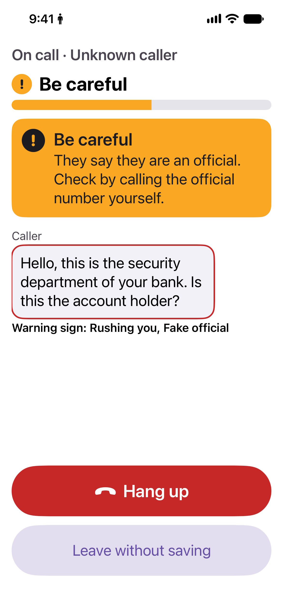
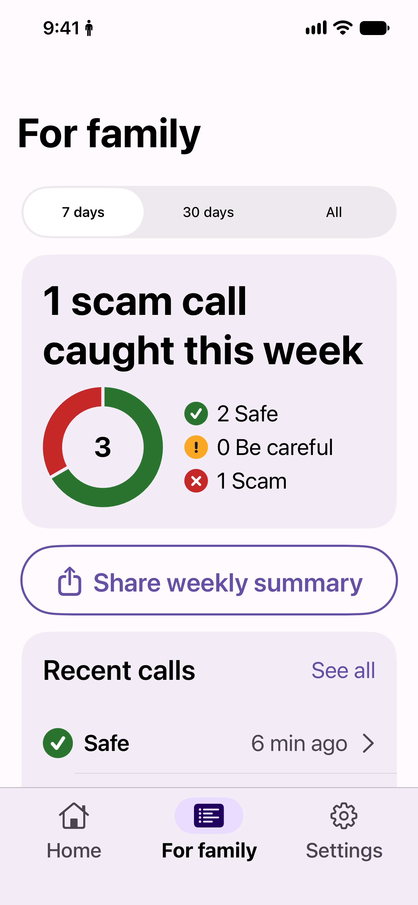
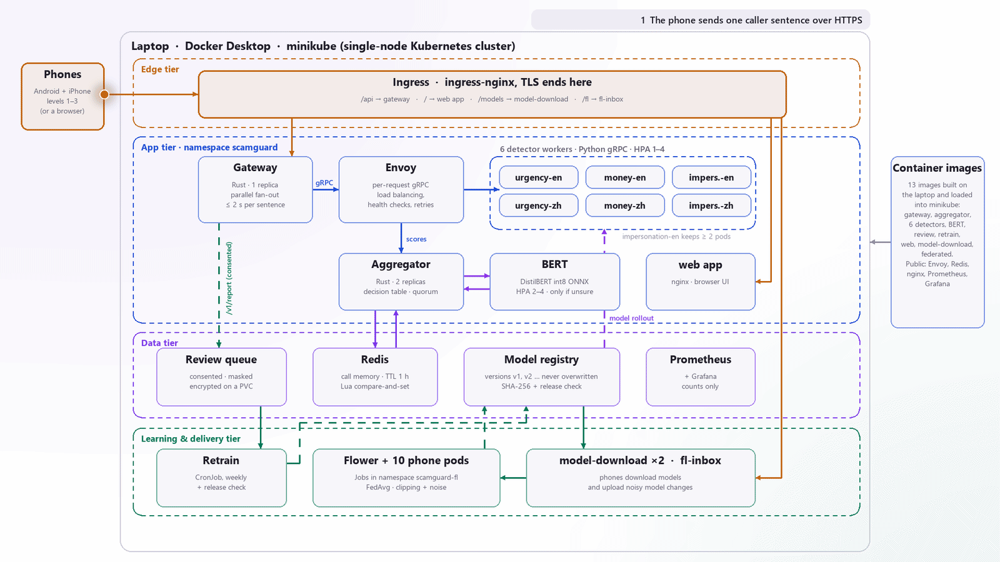

<p align="center">
  
</p>

<h1 align="center">ScamGuard</h1>
<p align="center"><b>A cloud-native system that warns you <i>during</i> a scam call — not after the money is gone.</b></p>

<p align="center">
  
  
  
  
  
  
  
</p>

Phone scams cost victims hundreds of millions of dollars a year, almost always through a live call where
the scammer builds urgency and authority until the victim transfers money themselves. By the time a bank
or a police report gets involved, the money is usually gone. **ScamGuard listens alongside the call** (on
Android and iPhone, in English and Mandarin) and warns the user while it is still happening.

Under the hood it's a distributed, fault-tolerant microservice backend: every sentence the caller says is
scored in parallel by six lightweight detectors, a stateless aggregator keeps the call's running verdict in
Redis, and a DistilBERT model is pulled in as a second opinion only when the fast models are unsure or
alarmed — a cascade that keeps the system fast, explainable, and still working if the expensive model is
slow or down. Everything runs on Kubernetes with autoscaling, health checks, and zero-downtime rollouts, and
users who want more privacy can run the detectors on-device instead, with the on-device models improving
over time through federated learning.

## Screenshots

<table>
<tr>
<td></td>
<td></td>
<td></td>
<td></td>
</tr>
<tr>
<td align="center">Onboarding</td>
<td align="center">Scam detected, live</td>
<td align="center">Unsure, caution</td>
<td align="center">Family dashboard</td>
</tr>
</table>

More: [after-call guidance](docs/images/screenshot-after-call.png) ·
[scam-awareness quiz](docs/images/screenshot-learn.png) ·
[privacy levels](docs/images/screenshot-privacy-levels.png)

The same app also ships as a native [Android client](android-app/) and a [browser replica](web/) with no
install required.

## Architecture



Each caller sentence goes from the phone, through an Ingress, to a Rust gateway that fans it out to six
language/signal detectors over gRPC. A stateless aggregator combines their scores with the call's history in
Redis and calls in a DistilBERT model as a second opinion only when the result is unsure or alarming — a
**cascade** that stays fast and keeps answering even if BERT is down. Two learning loops (a consent-based
cloud loop and a federated, on-device loop) keep the models improving without ever collecting raw calls.

**Full breakdown:** [docs/ARCHITECTURE.md](docs/ARCHITECTURE.md) — every component, the cascade decision
table, the learning loops (with an animated diagram), Kubernetes, and the repo layout.

## Privacy levels

| Level | What runs where | What ever leaves the phone |
|---|---|---|
| **Cloud** | Interface only; everything scored in the cluster | Each sentence, scored and never stored |
| **Hybrid** | The three detectors + rules run on the phone | Only the last 5 sentences, masked, and only when the local verdict is unsure |
| **On-device** | Detectors + MobileBERT run on the phone | Nothing about calls — only optional, noised model updates |

Levels 2 and 3 run the same decision rules as the cloud aggregator (ported to Kotlin and Swift, with unit
tests asserting parity), so switching privacy level doesn't change what counts as a scam — only where the
scoring happens.

## Security & privacy

- **Nothing is stored by default.** A call's history lives only in Redis with a 1-hour TTL; the transcript
  text itself is never logged or persisted unless the user explicitly shares a finished call.
- **Explicit consent to share.** Sharing a call is rejected outright without consent — there is no implicit
  collection path.
- **Masked, then masked again, then encrypted.** A shared call is masked on the phone, masked a second time
  on the server, and stored encrypted at rest (the encryption key is a Kubernetes Secret, kept separate from
  the data volume). Unapproved reports are deleted after 30 days.
- **HTTPS at the edge.** The Ingress terminates TLS with its own certificate authority; a plain-HTTP request
  is rejected.
- **Differential privacy in federated learning.** Phones never upload raw data, only a clipped, Gaussian-
  noised change to the on-device model, which the server averages across phones (FedAvg) before it can ever
  affect the shared model — and even then, only after passing the same release check as a cloud retrain.
- **Internal services stay internal.** Only the gateway, the web app, model downloads, and the federated
  update inbox are reachable from outside the cluster; the review queue and model registry are not.

## Reliability, at a glance

Measured on a single-node Kubernetes cluster (minikube), replaying real scripted scam and normal calls
end-to-end through the live stack:

| | Result |
|---|---|
| Median latency, light load | **41 ms** (p99 108 ms) |
| Median latency, heavy load (50 req/s) | 419 ms (p99 1,541 ms — still inside the 2 s budget) |
| Call-level detection F1 | **0.923** across 23 scripted calls (13 scam, 10 normal, English + Mandarin) |
| Pod killed mid-call (detector) | **0 failed requests** — call history and verdict survived |
| Pod killed mid-call (aggregator) | 6 of 1,628 requests failed (0.37%), all within 3 s; both replicas healthy after |
| Rolling model update / rollback mid-call | **0 failed requests**, 0 missing sentences |
| Autoscaling under load | Every detector and BERT scaled out automatically (CPU target 50%) |
| BERT unreachable | System kept deciding without it — the cascade's whole point |

These are real measurements from load, fault-injection and replay tests against a running cluster, not
estimates — per-model accuracy and known weak spots are in [docs/MODELS.md](docs/MODELS.md).

## Tech stack

| Layer | Technology |
|---|---|
| Gateway & aggregator | Rust (Actix-web, tonic/gRPC) |
| Detection models | Python, gRPC, scikit-learn (TF-IDF + logistic regression) |
| Second-opinion model | DistilBERT (multilingual), ONNX Runtime, int8 quantised |
| Call memory | Redis (optimistic concurrency via a versioned Lua script) |
| Service mesh / load balancing | Envoy (per-request gRPC load balancing + health checking) |
| Orchestration | Kubernetes (minikube for local demo), HPA autoscaling, Ingress + TLS |
| Federated learning | Flower, with gradient clipping + Gaussian noise (differential privacy) |
| Android client | Kotlin, Jetpack Compose, Room |
| iOS client | SwiftUI, Swift Concurrency, SwiftData, ONNX Runtime (on-device MobileBERT) |
| Browser client | Static HTML/CSS/JS replica, no build step |
| Local dev | Docker Compose |

## Getting started

**Full step-by-step instructions (web, Android Studio, Xcode): [HOW_TO_RUN.md](HOW_TO_RUN.md).**

| I want to... | Do this | Time |
|---|---|---|
| Run the whole backend on a laptop with Docker only | [Docker Compose](#docker-compose-laptop-docker-only) | ~15 min first build |
| See the distributed-systems features (replicas, autoscaling, pod kills, rolling updates, federated pods) | [Kubernetes demo](demo/README.md) | ~20 min first build |
| Try it on an Android phone or emulator | [android-app/](android-app/) | 10 min |
| Try it on iPhone | [ios-app/](ios-app/) | 10 min, Mac + Xcode |
| Try it in a browser, no install | [web/](web/) | 2 min |
| Review reported calls (accept / reject / label) | the review website, see [HOW_TO_RUN.md](HOW_TO_RUN.md) | 2 min |
| Check federated learning on its own, no containers | [backend/federated/README.md](backend/federated/README.md) | 10 min |

Needs: Docker Desktop (8 GB memory for Docker is enough), Python 3.10+ for the helper scripts, and for the
Kubernetes demo, `minikube` + `kubectl`. Windows: use the `.ps1` scripts; macOS/Linux: the `.sh` ones.

### Docker Compose (laptop, Docker only)

```bash
docker compose up -d --build            # gateway, aggregator, Redis, 6 workers, BERT, review, model-service, edge
docker compose ps                       # wait until everything is Up
python tools/gateway_test.py --no-stop  # end-to-end check: scam line -> warning, calm line -> SAFE
python tools/testing/replay.py --only scam_en_11 --caller-only   # replay one scripted call, line by line
```
- **The app in a browser: http://127.0.0.1:8088/** (`web/`: the mobile app's cloud mode, no install needed;
  Android Studio / Xcode are only needed for the native apps and their on-device privacy levels).
- The phone/emulator address is the **edge** (same job as the Kubernetes Ingress): `http://<laptop IP>:8088/api/`
  (emulator: `http://10.0.2.2:8088/api/`). `/models` and `/fl` (on-device model downloads and training uploads)
  are on the same address.
- Federated learning round (Flower server + 10 simulated phones + real-phone bridge), publishes passing models:
  `docker compose --profile federated up --build fl-server fl-phones fl-bridge` (exits when done; results in
  `backend/federated/results/`).
- Stop: `docker compose down` (add `-v` to also delete the review queue and model registry).

Try it against a live backend:

```bash
curl -X POST http://localhost:8080/v1/utterance \
  -H "Content-Type: application/json" \
  -d '{"call_id": "demo-1", "seq": 1, "speaker": "caller", "lang": "en", "text": "This is the police. Transfer the money to the safe account now and read me the OTP."}'
```

The address is a setting in the app (**Settings** → server address), not in the code. Kubernetes:
`https://<laptop IP>:8443/api/` from `demo/expose.ps1`; the emulator reaches the laptop as `10.0.2.2`.

## Learn more

| Doc | Covers |
|---|---|
| [docs/ARCHITECTURE.md](docs/ARCHITECTURE.md) | Every component, the cascade decision table, the learning loops (animated diagram), Kubernetes, repo layout |
| [docs/API.md](docs/API.md) | The gateway's `/v1/utterance` request/response shapes, settings, and the aggregator's full rule table, Redis schema and env vars |
| [docs/MODELS.md](docs/MODELS.md) | Each detector's version, test scores and known weak spots; how to train or retrain a model; the BERT second opinion |
| [demo/README.md](demo/README.md) | Running the Kubernetes demo: setup, exposing it to a phone, showing autoscaling/fault-tolerance, troubleshooting |
| [backend/federated/README.md](backend/federated/README.md) | Federated learning and on-device model updates in plain words |

## Credits

Built by a team of six as a university group project: Mufliha, Rhaylene, Maryam, Mridula, Shreya and
Goutham. Everyone contributed across the backend, the detection models, the mobile apps, and the
Kubernetes/deployment work.

## License

[MIT](LICENSE)
