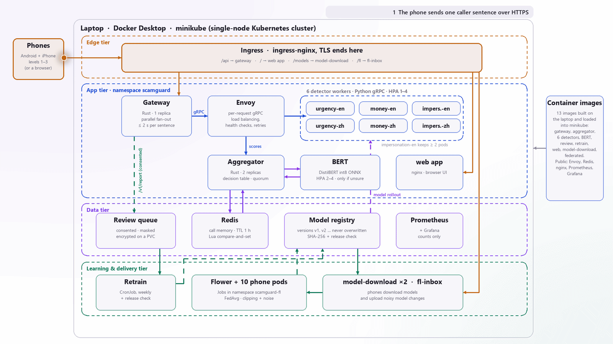
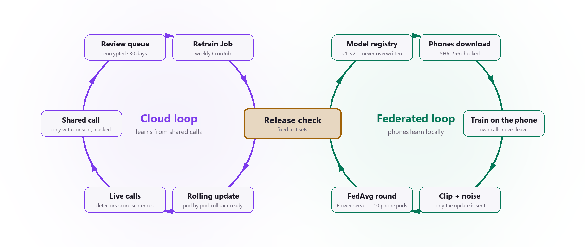

# Architecture

[← Back to the overview](../README.md)



A phone sends each sentence over HTTPS to the cluster's only public entry point, the Ingress. From there:

- **gateway** (Rust, Actix-web + tonic) — the phone's one entry point. For every caller sentence it calls
  that language's three detectors at once over gRPC (≤ 1.4 s) and forwards whatever scores arrive in time
  to the aggregator.
- **Envoy** — sits in front of every scalable gRPC service. A plain Kubernetes Service load-balances
  *connections*, not *requests*, which does nothing for long-lived gRPC streams; Envoy spreads individual
  requests across replicas and health-checks every pod.
- **6 detectors** (Python, gRPC, scikit-learn) — `{urgency, money/OTP, impersonation} × {English, Mandarin}`,
  independently scalable, independently retrainable. Each is a calibrated TF-IDF + logistic-regression model
  trained to an explicit labelling rule, so a detector never invents a score for a sentence it can't explain.
- **aggregator** (Rust, tonic) — the judge. Holds no per-call state itself: a call's history lives in Redis
  (TTL 1 hour), so any aggregator replica can answer any sentence, and a restart loses nothing. Two replicas
  can safely race to update the same call thanks to optimistic concurrency control (a versioned Lua
  compare-and-set in Redis).
- **BERT** (multilingual DistilBERT, int8 ONNX) — the second opinion. Reads the call's last 5 sentences
  together rather than one at a time, and is asked only when the fast vote is uncertain or alarming — see
  [the cascade decision policy](#the-cascade-decision-policy) below.
- **Learning loop** — a consent-based review queue, a weekly retraining job, and a federated-learning round
  (Flower, differential privacy) that improves the on-device models without ever collecting raw calls.

Full request/response shapes, environment variables, and the Redis schema are documented in
[API.md](API.md); model versions, training steps and known weak spots are in [MODELS.md](MODELS.md).

### The cascade decision policy

Six detectors score a sentence in about a millisecond each; DistilBERT needs 30–80 ms on a CPU. Running
BERT on everything would be slow and gives no answer if it's ever unavailable — running only the fast
models misses subtler scams. The cascade gets most of BERT's accuracy for a fraction of its cost, and never
stops answering if BERT goes down:

| Fast detectors | BERT (last 5 sentences) | Result |
|---|---|---|
| Calm (< 0.45) | Not asked | 🟢 SAFE |
| Unsure (0.45–0.6) | Not asked yet | 🟡 UNSURE, ask BERT |
| Unsure or alarmed | Scam (≥ 0.6) | 🔴 SCAM |
| Alarmed (≥ 0.6) | Uncertain (0.3–0.6) | 🟡 UNSURE |
| Alarmed (≥ 0.6) | Safe (< 0.3) | 🟡 UNSURE — never straight to SAFE |
| Any | BERT times out or is down | Fast-model result, capped at 🟡 unless two signals are ≥ 0.8 |

A single sentence can never flip a call straight to SCAM on its own: a red alert always needs BERT's
agreement (or two independent detectors scoring ≥ 0.8 if BERT is unreachable), and it only clears after two
consecutive BERT disagreements. The full rule table is in [API.md](API.md#aggregator).

## Learning, without storing conversations

Two loops share one release check and one versioned model registry: the cloud loop retrains the shared
detectors from consented, reviewed reports; the federated loop improves the on-device models from clipped,
noised updates that phones upload without ever sending a call's text.



## Kubernetes

The maintained manifests are generated into [demo/k8s/](../demo/k8s/) by `demo/make_manifests.py` (don't
hand-edit them): Deployments with readiness/liveness probes and resource limits, HPAs on every worker and
BERT, Envoy for per-request gRPC load balancing, Redis, the Ingress with HTTPS, the review service with a
volume, the retraining CronJob, and (optional, `demo/k8s/federated/`) the model-download service, the
update inbox and the federated-learning Jobs. [k8s/](../k8s/) holds older per-worker templates. How to run it:
[Kubernetes demo](../demo/README.md).

## Repo layout

```
backend/
  proto/scam_detect.proto       shared gRPC contract
  gateway/                      Rust + Actix-web HTTP front door, gRPC fan-out
  aggregator/                   Rust gRPC Aggregate endpoint: decision rules (policy.rs), settings (config.rs),
                                call memory in Redis (store.rs)
  workers/
    urgency_en/ urgency_zh/
    money_en/ money_zh/
    impersonation_en/ impersonation_zh/
    common_zh/                  ONE shared ZH text_norm.py + train_zh.py + gold set + probes, copied into each ZH image
    bert/                       BERT second opinion (ONNX), model files fetched at build
  federated/                    federated learning server, phone simulator, release checks
data/                            training data per worker (data/urgency_en/archive/ = cleaning history)
tools/                           datagen, eval helpers, zh_check (try the 3 ZH workers interactively),
                                 zh_eval.py (gold + probes, as served), eval_cascade.py,
                                 bert_dummy_model.py, gateway_test.py + aggregator_replay.py (end-to-end checks)
notebooks/bert_cascade.ipynb     BERT training (Colab): data windows, fine-tune, calibrate, ONNX export
tools/testing/                   demo-call replay + expected verdicts + window experiment
android-app/                    Kotlin + Jetpack Compose client
ios-app/                        SwiftUI client
web/                             browser replica of the app, no build step
demo/                            Kubernetes demo: manifests, load/chaos/replay tooling, setup scripts
k8s/                             Deployment/Service/HPA templates, bert.yaml
docker-compose.yml               local dev stack (incl. Redis)
```

